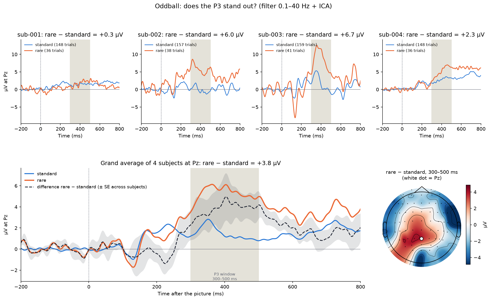
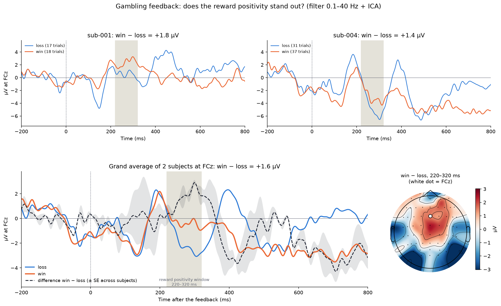

# ERPs in the oddball and gambling tasks (ds003517, sub-001 to sub-004)

Data: OpenNeuro **ds003517** (Cavanagh & Castellanos, 2016, *NeuroImage*), run-01.
Question: after cleaning with ICA, does the **P3** stand out for rare pictures, and does the
**reward positivity** stand out for wins?

## Results



**Oddball, P3 at Pz.** Rare pictures give a larger positive wave than standard pictures between
300 and 500 ms. The difference is strongest over the back of the head, as expected for a P3.

| | sub-001 | sub-002 | sub-003 | sub-004 | Grand average |
|---|---|---|---|---|---|
| rare − standard, 300–500 ms | +0.3 µV | +6.0 µV | +6.7 µV | +2.3 µV | **+3.8 µV** |

Three of the four subjects show a clear P3. sub-001 shows almost none.



**Gambling feedback, reward positivity at FCz.** Wins give a more positive wave than losses
around 220–320 ms, strongest over the front-centre of the head.

| | sub-001 | sub-004 | Grand average |
|---|---|---|---|
| win − loss, 220–320 ms | +1.8 µV | +1.4 µV | **+1.6 µV** |

Only sub-001 and sub-004 have gambling trials, so this is N = 2.

## How the averages are made

1. **Clean each subject:**
   - Drop FT9, FT10, TP9 and TP10.
   - Filter 0.1–40 Hz on the continuous recording, then apply the average reference.
   - Run ICA and remove the components ICLabel calls eye, heart or muscle.
   - Cut epochs from −0.5 to 1.0 s with a −200 to 0 ms baseline, and drop any epoch above 200 µV peak-to-peak.
2. **Average the trials within each subject**, per condition. This gives one ERP per condition per subject (top rows of the figures).
3. **Average the subjects:** the grand average is the mean of the subjects' ERPs, and every subject counts equally (bottom rows).

Trials kept after cleaning:

| | standard | rare | loss | win |
|---|---|---|---|---|
| sub-001 | 148 | 36 | 17 | 18 |
| sub-002 | 157 | 38 | – | – |
| sub-003 | 159 | 41 | – | – |
| sub-004 | 148 | 36 | 31 | 37 |

## Caveats

- 4 subjects (oddball) and 2 subjects (gambling) out of 17 in the dataset. The shaded band
  around the difference is the standard error across subjects.
- Times are from the trigger. The screen shows each picture **40 ms later**, so the true
  latencies are about 40 ms earlier. Add `--shift-ms 40` to correct this.
- sub-001 had 13 of 35 ICA components removed, mostly labelled muscle. Its components should
  be checked before trusting its near-zero P3.

## Run it

```bash
pip install -r erp/requirements.txt
python erp/erp_oddball_gambling.py <data_root> erp/figures sub-001 sub-002 sub-003 sub-004
```

`<data_root>` contains `sub-001/eeg/...` from https://openneuro.org/datasets/ds003517.
The data are not stored in this repository.
