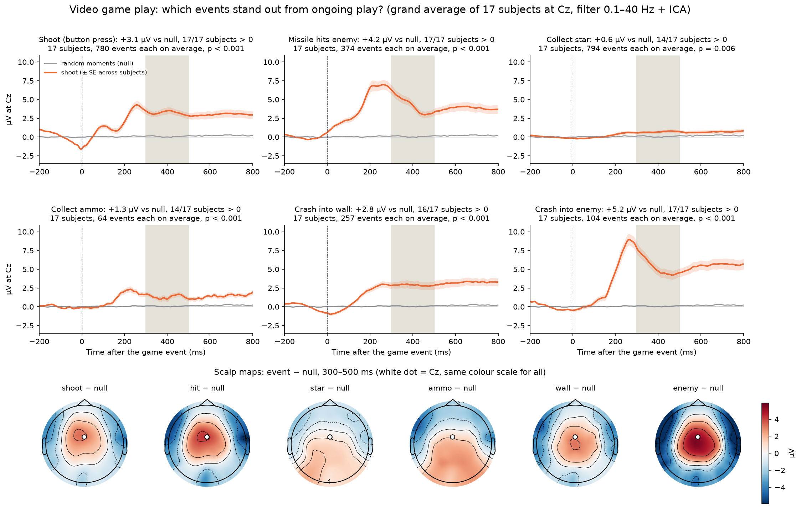

# ERPs in the oddball, gambling and video game tasks (ds003517, all 17 subjects)

Data: OpenNeuro **ds003517** (Cavanagh & Castellanos, 2016, *NeuroImage*), run-01.
Questions, after cleaning with ICA:
- Oddball and gambling (run-01): does the **P3** stand out for rare pictures, and the **reward positivity** for wins?
- Continuous game play (run-02): which **game events** stand out from ongoing play?

## Results


**Oddball, P3 at Pz (17 subjects).** Rare pictures give a larger positive wave than standard
pictures between 300 and 500 ms. The difference is strongest over the back-centre of the head,
as expected for a P3.

| | effect at Pz, 300–500 ms |
|---|---|
| Grand average, rare − standard | **+5.1 µV** (± 0.7 SE across subjects) |
| Subjects with a positive effect | **17 of 17** |
| One-sample t-test across subjects | t(16) = 7.2, p < 0.001 |


**Gambling feedback, reward positivity at FCz (14 subjects).** Wins give a more positive wave
than losses around 220–320 ms, strongest over the front-centre of the head.

| | effect at FCz, 220–320 ms |
|---|---|
| Grand average, win − loss | **+2.1 µV** (± 0.2 SE across subjects) |
| Subjects with a positive effect | **14 of 14** |
| One-sample t-test across subjects | t(13) = 8.9, p < 0.001 |

sub-002, sub-003 and sub-005 have no gambling trials in run-01, so the gambling figure has 14 subjects.

### Each subject's effect, oddball and gambling (µV)

| | 001 | 002 | 003 | 004 | 005 | 006 | 007 | 008 | 009 | 010 | 011 | 012 | 013 | 014 | 015 | 016 | 017 |
|---|---|---|---|---|---|---|---|---|---|---|---|---|---|---|---|---|---|
| P3, rare − standard | +0.3 | +6.0 | +6.7 | +2.3 | +3.4 | +4.8 | +12.8 | +8.6 | +5.3 | +5.3 | +4.5 | +2.5 | +2.7 | +4.5 | +9.2 | +3.8 | +4.9 |
| RewP, win − loss | +1.8 | – | – | +1.4 | – | +2.2 | +2.6 | +1.6 | +1.0 | +2.1 | +2.2 | +4.5 | +1.6 | +2.9 | +1.3 | +1.7 | +2.9 |



**Continuous game play, six game events at Cz (17 subjects).** These are the six events the
authors analysed, measured at Cz as in their script. Each event is compared with **null epochs**:
500 random moments of gameplay per subject, cleaned and averaged the same way. If an event did
nothing, its curve would lie on the grey null line. The effect is event − null, mean of 300–500 ms
(the same window as the oddball P3).

| Game event | events per subject (mean) | event − null at Cz | subjects > 0 | t(16), p |
|---|---|---|---|---|
| Crash into enemy | 104 | **+5.2 µV** | 17 / 17 | 9.4, p < 0.001 |
| Missile hits enemy | 374 | **+4.2 µV** | 17 / 17 | 9.1, p < 0.001 |
| Shoot (button press) | 780 | **+3.1 µV** | 17 / 17 | 8.8, p < 0.001 |
| Crash into wall | 257 | **+2.8 µV** | 16 / 17 | 6.0, p < 0.001 |
| Collect ammo | 64 | **+1.3 µV** | 14 / 17 | 4.7, p < 0.001 |
| Collect star | 794 | **+0.6 µV** | 14 / 17 | 3.1, p = 0.006 |

- **Crashing into an enemy** gives the largest response, a positive peak around 250 ms over the
  centre of the head. Missile hits look similar but smaller.
- **Collecting a star** happens about 800 times per subject and gives almost no response: it is
  frequent and expected, so the brain barely reacts.
- The rare, important events (enemy crash, enemy hit) give the biggest waves, like the rare
  pictures in the oddball task.
- Per-subject numbers and epoch counts are in `erp/figures/summary_gameplay.txt`.

## How the averages are made

1. **Clean each subject:**
   - Drop FT9, FT10, TP9 and TP10.
   - Filter 0.1–40 Hz on the continuous recording, then apply the average reference.
   - Run ICA and remove the components ICLabel calls eye, heart or muscle.
   - Cut epochs from −0.5 to 1.0 s with a −200 to 0 ms baseline, and drop any epoch above 200 µV peak-to-peak.
2. **Average the trials within each subject**, per condition. This gives one ERP per condition per subject (small panels).
3. **Average the subjects:** the grand average is the mean of the subjects' ERPs, and every subject counts equally (large panel).

Trials kept after cleaning (oddball and gambling, run-01) and the number of ICA components removed:

| | standard | rare | loss | win | ICA removed |
|---|---|---|---|---|---|
| sub-001 | 148 | 36 | 17 | 18 | 13 of 35 |
| sub-002 | 157 | 38 | – | – | 4 of 24 |
| sub-003 | 159 | 41 | – | – | 7 of 30 |
| sub-004 | 148 | 36 | 31 | 37 | 4 of 26 |
| sub-005 | 155 | 39 | – | – | 7 of 18 |
| sub-006 | 156 | 41 | 120 | 120 | 11 of 31 |
| sub-007 | 65 | 19 | 40 | 38 | 3 of 29 |
| sub-008 | 102 | 24 | 28 | 31 | 1 of 31 |
| sub-009 | 158 | 39 | 40 | 40 | 5 of 21 |
| sub-010 | 159 | 40 | 40 | 40 | 4 of 26 |
| sub-011 | 160 | 40 | 40 | 40 | 3 of 24 |
| sub-012 | 160 | 40 | 40 | 40 | 3 of 29 |
| sub-013 | 148 | 39 | 40 | 40 | 4 of 28 |
| sub-014 | 148 | 40 | 40 | 40 | 4 of 32 |
| sub-015 | 155 | 40 | 35 | 38 | 2 of 44 |
| sub-016 | 160 | 40 | 36 | 37 | 3 of 36 |
| sub-017 | 150 | 35 | 40 | 38 | 7 of 29 |

## When to drop a subject

**No subject is dropped at the moment.** The rule for dropping someone has to be decided
**before** looking at the results, and must be about **data quality**, never about the size of
the effect. Dropping sub-001 because its P3 is small would be cherry-picking.

Usual reasons to drop a subject:
1. **Too few clean trials:** for example, less than 50% of the trials of any condition kept.
2. **A broken recording:** many bad channels, the cap moved, or the file is damaged.
3. **The person did not do the task:** for example, they fell asleep or pressed at random.

Trials kept in the oddball task (all other subjects keep at least 85% of each condition):

| | standard kept | rare kept | under a "keep ≥ 50%" rule |
|---|---|---|---|
| sub-007 | 65 of 156 (42%) | 19 of 44 (43%) | **drop** |
| sub-008 | 102 of 160 (64%) | 24 of 40 (60%) | keep |
| sub-001 | 148 of 159 (93%) | 36 of 41 (88%) | keep (small effect, good data) |

Without sub-007 the oddball P3 grand average would be about +4.7 µV instead of +5.1 µV, and every
remaining subject is still positive, so the conclusion does not depend on this choice.
In the game play data every subject keeps at least 78% of the null epochs.

## Caveats

- Times are from the trigger. The screen shows each picture **40 ms later**, so the true
  latencies are about 40 ms earlier. Add `--shift-ms 40` to correct this.
- sub-007 and sub-008 lost many oddball trials to the 200 µV rule (65 and 102 of about 160
  standard trials kept), so their averages are noisier.
- sub-001 had 13 of 35 ICA components removed, mostly labelled muscle, and has the weakest P3
  (+0.3 µV). Its components should be checked.
- sub-006 has 120 win and 120 loss trials in run-01, about three times as many as the others.
  Every subject still counts equally in the grand average.
- Game events come close together (a shot every 2–3 s on average), so one epoch often contains the
  response to the next event too. This is why the game curves stay above zero after 500 ms.
- Shooting is a button press, so the brain prepares the movement before time 0; part of the
  shoot curve reflects that movement, not a reaction to something seen.
- For enemy crashes and missile hits the peak is around 250 ms, earlier than the 300–500 ms
  window, so the table underestimates their peak size.

## Run it

```bash
pip install -r erp/requirements.txt
python erp/erp_oddball_gambling.py <data_root> erp/figures sub-001 sub-002 ... sub-017
python erp/erp_gameplay.py         <data_root> erp/figures sub-001 sub-002 ... sub-017 --cache <cache_dir>
```

`<data_root>` contains `sub-001/eeg/...` from https://openneuro.org/datasets/ds003517.
The data are not stored in this repository. A full run takes about 20 minutes for run-01 and about an hour for run-02 (game play), mostly ICA.
`--cache` keeps each subject's averages so the game play figure can be redrawn in seconds.
